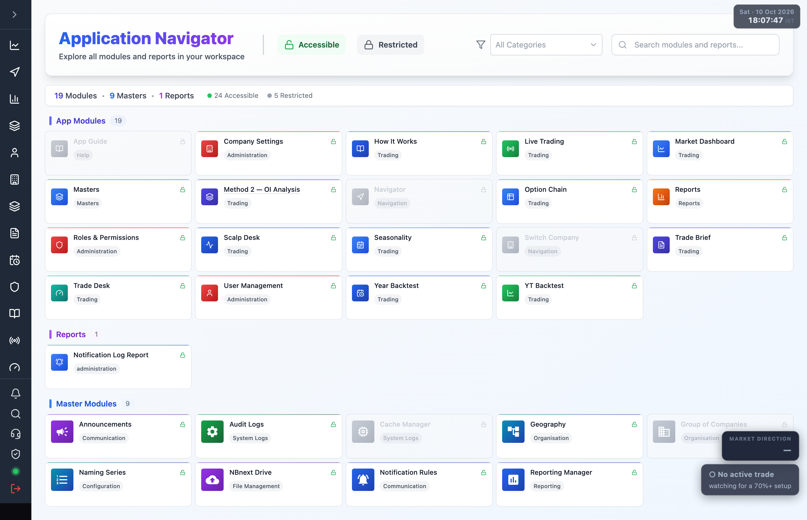

# 7.1 Trading platform overview {#trading-overview}

The trading platform reads live NIFTY / BANK NIFTY / SENSEX market data from a Zerodha
(Kite Connect) account, scores it with several option-buying engines, and either shows the
call or places the order for you.

## The modules at a glance {#modules}

Every screen opens from the **Application Navigator** (the `/admin` home) or the left sidebar.

| Module | What it is for |
| --- | --- |
| [Market Dashboard](./04-market-dashboard.md) | NIFTY/BANKNIFTY chart, live signal, market direction. |
| [Method 2 — OI Analysis](./05-method-2.md) | 8-factor option-buying engine: conviction, gates, trade lifecycle. |
| [Trade Brief](./05-method-2.md#trade-brief) | Plain-language brief of the current Method 2 call. |
| [Trade Desk](./06-trade-desk.md) | One-glance decision screen: state, conviction, factor board. |
| [Live Trading](./07-live-trading.md) | Auto-execution desk — off / dry / live, account read-back, GTT, day book. |
| [Scalp Desk](./08-scalp-desk.md) | Mean-reversion scalp engine: regime read, paper record, backtests. |
| [Option Chain](./09-option-chain.md) | Live option chain with OI, spreads and support/resistance walls. |
| [Year Backtest / YT Backtest](./10-backtests.md) | One-year strategy backtest reports. |
| [Seasonality](./11-seasonality.md) | Repeating calendar patterns + the live seasonal tilt switch. |
| [How It Works](./12-how-it-works.md) | How the engines decide; parameter history. |

## Before you start {#before-you-start}

1. [Connect your Zerodha account](./02-connect-zerodha.md). Until the broker is connected and
   the daily access token is set, the data screens show **"Zerodha token expired — data
   unavailable"** and charts stay empty.
2. Review the [trading configuration](./03-trading-configuration.md) — symbols, market session,
   and the strategy tunables that drive every engine.

:::note Market hours
Live data and signals only move during NSE market hours (09:15–15:30 IST, Mon–Fri). Outside
the session the engines hold, and the dashboards show the last known state or an empty state.
:::

## The trade status pill {#trade-status-pill}

Every screen carries a floating **market direction / trade status** pill in the bottom-right
corner. It shows the current bias (bullish / bearish / neutral) and whether a trade is active,
so you always know what the engine is doing without opening a dashboard.
