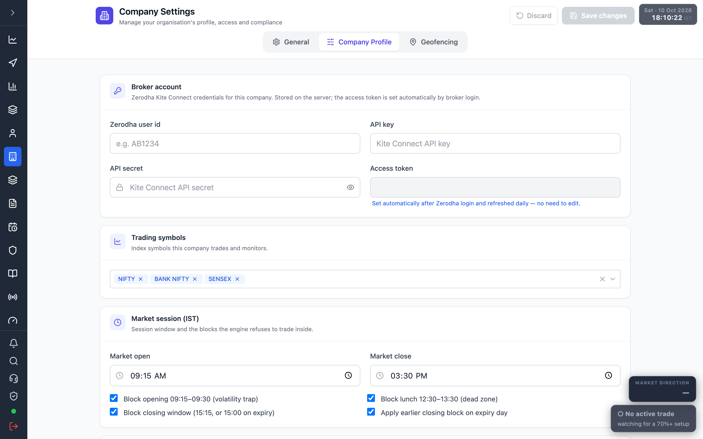

# 7.2 Connect your Zerodha account {#connect-zerodha}

Every live screen reads market data through a Zerodha **Kite Connect** account. Connecting is a
one-time credential setup, then a **daily login** to refresh the access token.

## 1. Enter your Kite Connect credentials {#credentials}

Open <a href="/admin/company" target="_blank" rel="noopener noreferrer">Company Settings → Company Profile</a>
and fill in the **Broker account** section.



| Field | What to enter |
| --- | --- |
| Zerodha user id | Your Kite login id (e.g. `AB1234`). |
| API key | The Kite Connect app's API key. |
| API secret | The Kite Connect app's API secret. |
| Access token | Leave blank — set automatically after login (see below). |

Click **Save changes**. Credentials are stored on the server against this company.

:::note Where to get the API key/secret
Create a Kite Connect app at the Zerodha developer console (`developers.kite.trade`). Your API
key and secret come from that app.
:::

## 2. Set the redirect (callback) URL {#callback}

In the Kite Connect app settings, set the **Redirect URL** to this server's callback:

```
http://<your-server-host>:8469/api/v1/zerodha/callback
```

The callback URL is configured on the server via the `ZERODHA_CALLBACK_URL` environment
variable (default `http://localhost:8469/api/v1/zerodha/callback`). The value in the Kite app
and the server must match exactly, or the login round-trip fails.

## 3. Log in daily {#daily-login}

The Zerodha access token expires every day. Whenever you see
**"Zerodha token expired — data unavailable"** on a dashboard:

1. Click **Login to Zerodha →** (on the Market Dashboard banner, or any data screen).
2. Sign in on Zerodha's Kite page and authorise the app.
3. Zerodha redirects back to the callback; the server exchanges the request token for the
   access token, saves it to the company profile, and shows **"✓ Zerodha Login Successful"**.
4. You are redirected to the dashboard — data now flows.

Once connected, the token is **refreshed automatically each day**, so you normally log in once
at the start of the trading session.

## Troubleshooting {#troubleshooting}

| Symptom | Cause / fix |
| --- | --- |
| "Zerodha token expired — data unavailable" | No valid access token for today. Log in again (step 3). |
| Login returns "Login failed" | API key/secret wrong, or the Kite app's redirect URL does not match `ZERODHA_CALLBACK_URL`. |
| Charts empty but no error banner | Market is closed (outside 09:15–15:30 IST) — there is no live data to show. |
