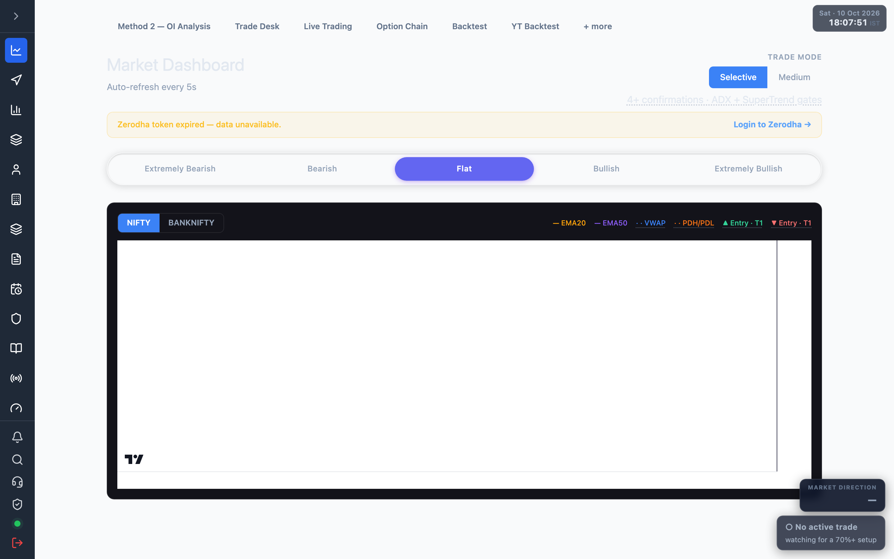

# 7.4 Market Dashboard {#market-dashboard}

Live NIFTY / BANK NIFTY chart, the master trade signal, and the market-direction read, all on one
auto-refreshing screen: <a href="/admin/market-dashboard" target="_blank" rel="noopener noreferrer">open Market Dashboard</a>.

The page refreshes every **5 seconds**.

:::note Empty state
Without a valid Zerodha access token the header shows **"Zerodha token expired — data unavailable"**
with a **Login to Zerodha →** link, and the cards stay empty. Live values only move during
[market hours](./01-overview.md). The chart fetches independently, so candles can still draw while
other cards are blank.
:::

## Header controls {#header}

| Control | What it does |
| --- | --- |
| Trade Mode toggle | Switches the signal between **Selective** and **Medium** (see below). |
| Session banner | **TRADING ACTIVE** / **TRADING BLOCKED** with the reason; flags **EXPIRY DAY**. |

## Trade Mode {#trade-mode}

Top-right toggle, two buttons:

- **Selective** — 4+ confirmations, ADX + SuperTrend gates (high precision).
- **Medium** — 3+ confirmations, no ADX/SuperTrend gates (more frequent signals).

This is the same signal-mode switch exposed in [Trading configuration](./03-trading-configuration.md#trade-mode).

## Market direction strip {#direction}

A five-step bar derived live from price vs EMA20/EMA50. The current read is highlighted:

**Extremely Bearish → Bearish → Flat → Bullish → Extremely Bullish**

## Chart {#chart}

A candlestick chart with overlays, pan/zoom, and scroll-back history (loads more candles as you
scroll left).

| Overlay | Meaning |
| --- | --- |
| EMA20 / EMA50 | Trend lines. |
| VWAP | Session volume-weighted average price (dashed). |
| PDH / PDL | Previous-day high / low (dashed). |
| S / R | Strongest swing support / resistance. |
| ▲ / ▼ Entry · T1 · SL | Breakout-scenario entry, target and stop markers. |
| Candle markers | Detected patterns (hammer, shooting star, engulfing, doji, marubozu). |

- **NIFTY / BANKNIFTY** buttons switch the charted symbol.
- Pan back to study history; a **● Go Live** button appears to snap to the latest candle.

## Master Signal {#master-signal}

Combines the signal engine with the chart breakout scenarios into one call:

- **Status** — CONFIRMED BUY/SELL, BUY/SELL (chart pending), SIGNAL CONFLICT, or WAIT — No Trade.
- **Master Confidence** — engine confidence adjusted by chart alignment (+10 confirmed, −5 conflict).
- **Option to buy** — the ATM CE/PE for the called direction.
- **Levels** — Trigger, Entry, Stop Loss, Target 1 (1.5R), Target 2 (2.5R), with risk and R/R.
- **Trades today: n/3** and an engine-breakdown toggle.

## Chart Breakout Scenarios {#scenarios}

BUY and SELL cards built from the visible swing S/R — trigger, entry, stop loss, Target 1 (1.5R),
Target 2 (2.5R) and R/R. They update as you pan the chart.

## Indicator cards {#cards}

| Card | Shows |
| --- | --- |
| NIFTY 50 / BANK NIFTY | Price, EMA20, EMA50, VWAP, RSI (with bias colour). |
| Put/Call Ratio | CE OI, PE OI, PCR, interpretation. |
| India VIX | VIX value, zone, trading allowed/blocked, SL factor. |
| Momentum Indicators | SuperTrend, MACD, Volume confirmation. |
| OI Analysis | OI change bias, Max Pain, OI support / resistance. |
| Price Levels | PDH, PDL, PDC, CPR pivot, day type. |

## Trade Signal card {#signal-card}

The raw engine output: call label, quality level, regime, entry / stop / targets, PCR weight, ATR,
and a **Show Confidence Breakdown** toggle listing each factor's points. See
[How it works](./12-how-it-works.md) for how the factors combine.

:::note
The floating market-direction / trade-status pill in the bottom-right corner follows you across
every screen — see [Overview](./01-overview.md#trade-status-pill).
:::
