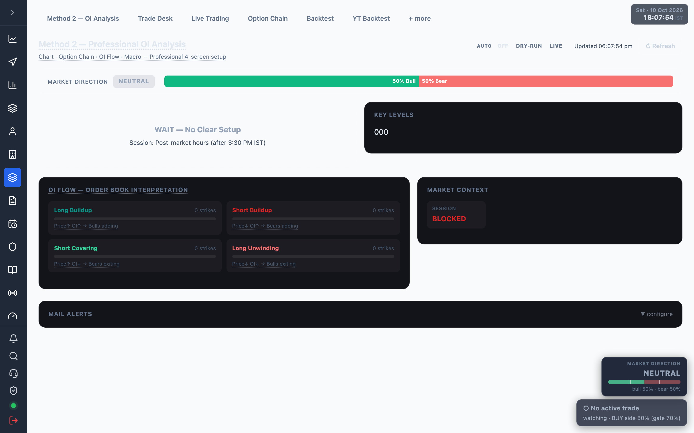
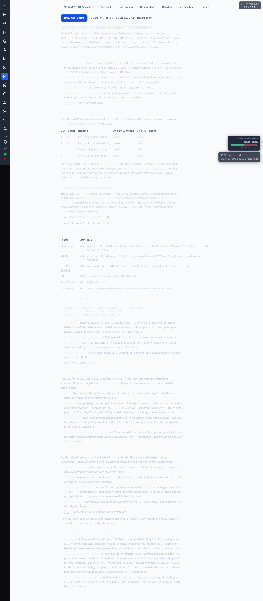

# 7.5 Method 2 — OI analysis {#method-2}

The option-buying engine: it reads the live option chain's open-interest behaviour plus price
confirmation into one confidence number, one call, and — when the call clears its gates — one managed
trade. Open it at <a href="/admin/method2" target="_blank" rel="noopener noreferrer">Method 2 dashboard</a>.

The page refreshes every second.

:::note Empty state
Without a valid Zerodha token the screen shows **"Zerodha token expired — data unavailable"** with a
**Login to Zerodha →** link. If every factor reads zero, the engine declares "no data" rather than a
fake 50/50. Values only move during [market hours](./01-overview.md).
:::

## Header {#header}

- **AUTO switch** — OFF / DRY-RUN / LIVE auto-execution of Method 2 calls. LIVE places real 2-lot MIS
  orders with the stop resting on the exchange and asks for confirmation first. Run DRY-RUN for a few
  days before arming LIVE. See [Live Trading](./07-live-trading.md).
- **Updated HH:MM:SS** timestamp and a **↻ Refresh** button.

## Direction bar {#direction}

Market Direction chip (BUY / SELL / NEUTRAL) and a split confidence bar showing **Bull %** vs **Bear %**.

## The call {#call}

The recommendation card. Confidence drives what happens:

| Confidence | State |
| --- | --- |
| &lt; 70% | **WAIT — No Clear Setup** (NEUTRAL). |
| 50–74% | **PREVIEW** — shown on screen, not emailed. |
| ≥ 75% | Emailed BUY / SELL call. |

A BUY buys the ATM call, a SELL the ATM put. The card shows action, symbol, expiry, spot, confidence,
**Entry** and **Stop Loss** premiums, three **Targets** (T1/T2/T3 with R:R), the **Underlying NIFTY
levels** (SL wall, OI resistance/support, max pain), and a **Why this trade** reasons list.

## Active trade {#active-trade}

When a gated call opens a trade, the Active Trade card stands until its levels resolve it: state
(ACTIVE / STOPPED / INVALIDATED / done), direction and symbol, confidence at entry, per-unit P&L, and
Entry / Now / Stop (trailed) / T1 / T2 / T3 / Wall levels. The **Enter now? n/10** meter rates taking
the trade fresh right now against the 70% gate; a MACD contradiction vetoes it.

## Panels {#panels}

| Panel | Shows |
| --- | --- |
| OI Flow | Long buildup, short buildup, short covering, long unwinding counts + per-strike table. |
| Key Levels | OI resistance / support walls, Max Pain, Spot, PCR. |
| Market Context | EMA20/50, VWAP, RSI, ADX, MACD, SuperTrend, VIX, session, ATM option premiums. |

## Signal Log {#signal-log}

A table of the last 7 days of signals: time, call, spot, entry/current/SL/T1/T2/T3 premiums,
confidence, EMA20/50, RSI, PCR, and an expandable per-row analysis.

## Mail Alerts {#mail-alerts}

Collapsible panel. Enter the mailer secret key to receive an email for every new BUY/SELL signal
(≥ 75% confidence) plus a daily 15:30 IST summary. **Send test email** confirms delivery once the key
is saved.

## Trade Brief {#trade-brief}

A plain-language, end-to-end explanation of exactly how a Method 2 trade is derived — open it at
<a href="/admin/brief" target="_blank" rel="noopener noreferrer">Trade Brief</a>.

It is a static reference document (not live data) with a **Copy entire brief** button. It walks through:

1. The data feeding the engine (live chain, ticker, 1-minute candles, VIX).
2. Reading the chain — long/short buildup, covering, unwinding (volume-validated, type-aware), ±25 pts.
3. PCR **trend**, not level, ±15 pts.
4. Price confirmation — EMA, MACD, OI S/R position, RSI, SuperTrend, ADX bonus (the other 45 pts).
5. Confidence maths and the gates: the 70% gate, MACD-contradiction veto, hard ADX/VIX gates, the 75%
   email threshold.
6. Building exits from the chain's own walls and max pain (not fixed percentages).
7. Managing the trade by data: ACTIVE / STOPPED / INVALIDATED / EOD, trailing stops.
8. What is measured versus what is still assumed.

The factor point weights referenced here line up with the
[confidence weights](./03-trading-configuration.md#weights) in Trading configuration.
