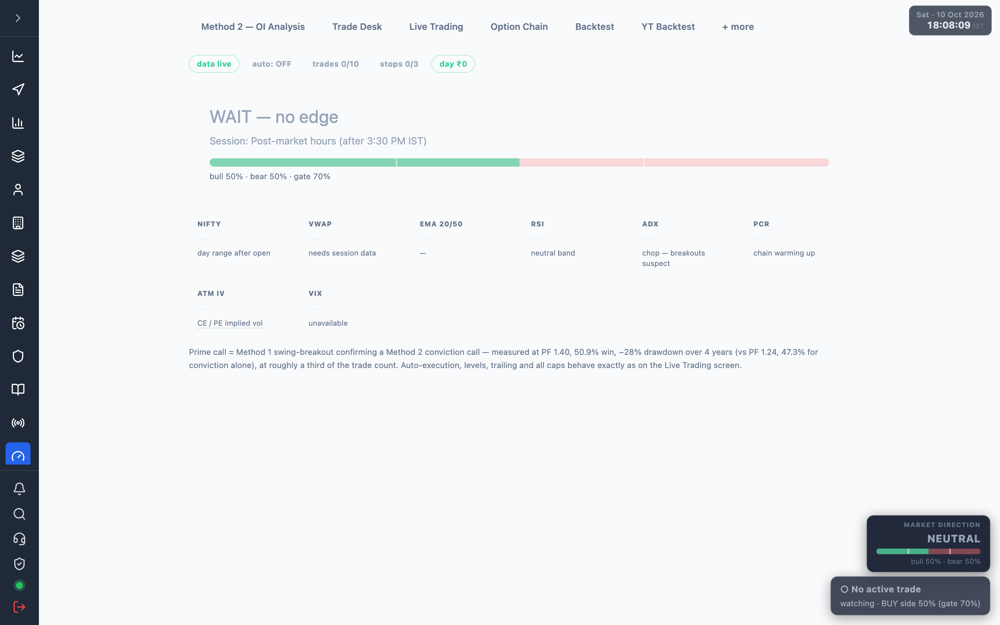

# 7.6 Trade Desk {#trade-desk}

The one-glance decision screen: can I trade right now, what is the call, what is running, how is the
day — in that order. Open it at
<a href="/admin/trade-desk" target="_blank" rel="noopener noreferrer">Trade Desk</a>.

The page refreshes every 5 seconds.

:::note Empty state
If the data feed is down the top strip shows a red **data: …** chip, and values read **—**. Live
numbers only move during [market hours](./01-overview.md).
:::

## Status strip {#strip}

A row of chips across the top:

| Chip | Meaning |
| --- | --- |
| data live / data: … | Feed healthy (green) or the error (red). |
| auto: OFF / DRY / LIVE | Auto-execution mode. |
| trades n/max | Trades taken today vs the daily cap. |
| stops n/max | Stop-outs today vs the cap. |
| day ₹… | Net rupees for the day (green positive, red negative). |
| ⛔ … | A block reason, when trading is halted. |
| month tilt | Seasonal bias for the month, when non-zero. |

## State banner {#banner}

The single thing to glance at. Its headline changes with the setup:

| State | Meaning |
| --- | --- |
| ★ PRIME BUY/SELL CALL | Conviction ≥ 70% **and** a live breakout agree — the highest-quality setup. |
| BUY/SELL CALL · n% | Conviction cleared the 70% gate; no breakout confirmation (standard grade). |
| Breakout fired — conviction not there | Price broke structure but conviction is below 70%. |
| FORMING · side at n% | Above 60%, below the 70% gate — watching, not calling. |
| IN TRADE · … | A position is live; resolves on its levels, not the mood. |
| WAIT — no edge | Factors split; standing aside. |

When no trade is open, a conviction bar shows **bull % · bear %** against the 70% gate markers.

## The call / the position {#call}

- **The call** (when there is a call and no open position) — symbol, Entry / Stop / T1 / T2 / T3
  premiums, and the top reasons. Marked **★ Prime call** when breakout-confirmed.
- **Position** (while a trade is live) — called-at confidence, Entry / Now / Stop (trailed) / T1 / T2 /
  T3, and the next machine moves (where the stop jumps to breakeven, how it trails, the wall guarding
  the thesis).

## Pro cards {#procards}

The at-a-glance context row: **NIFTY** (spot + day OHLC), **VWAP**, **EMA 20/50**, **RSI**, **ADX**,
**PCR**, **ATM IV** (CE/PE + skew), **VIX**. Each colours up/down and carries a one-line read.

## Live factor board {#factor-board}

**What's moving the needle** — every scored factor as a centred diverging bar (bull → / ← bear) with
its live points out of its maximum:

OI buildup (25) · PCR trend (15) · OI S/R (10) · EMA (15) · MACD (10) · RSI (10) · SuperTrend (5) ·
ADX bonus (5) · Seasonal (2) · Breakout (5).

Chain factors (OI, PCR, S/R) are 50 of 95 points; price factors the rest. The headline % is this board
summed and mapped to 0–100. Breakout and seasonal lean the verdict but are not scored into the 95. See
[How it works](./12-how-it-works.md) for the full method.

## Structure {#structure}

When swing structure is ready: the breakout-up and breakout-down triggers, the OI walls, and max pain —
the levels the next move must clear. A breakout through structure **with** conviction ≥ 70% is the prime
setup; either alone is not.

:::note
Auto-execution, levels, trailing and all caps behave exactly as on the
[Live Trading](./07-live-trading.md) screen.
:::
