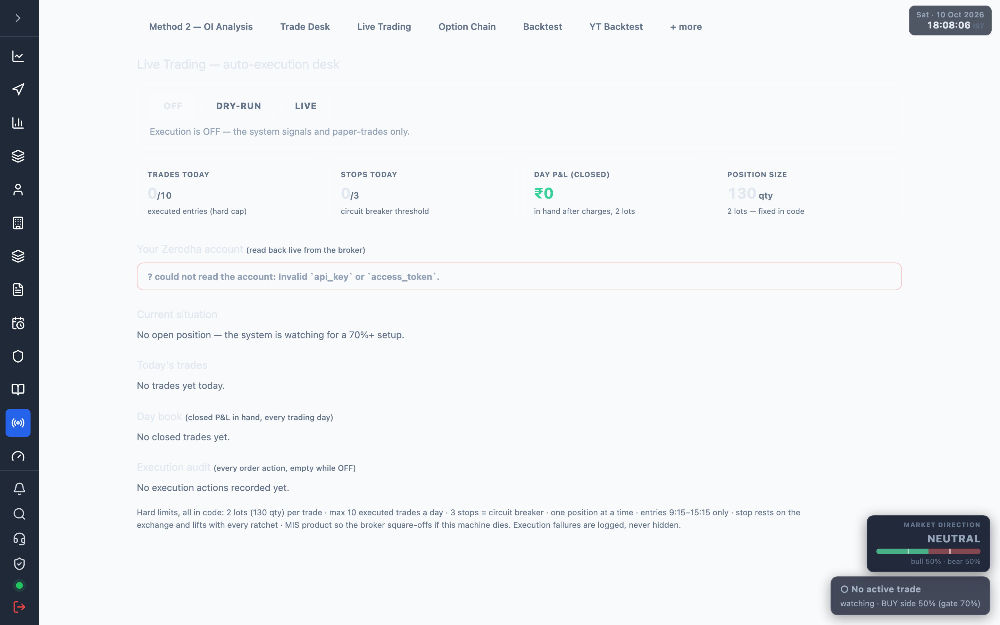

# 7.7 Live Trading {#live-trading}

The auto-execution desk: it turns the current Method 2 call into real orders, reads your
Zerodha account back live, and logs every action.

Open at <a href="/admin/live-trading" target="_blank" rel="noopener noreferrer">Live Trading</a>.
The state polls every ~2s; the day book refreshes every ~60s.

## Execution switch {#execution-switch}

Three buttons set what the engine does with a call. Mirrors the
[execution mode](./03-trading-configuration.md#trade-mode) in configuration.

| Mode | What happens |
| --- | --- |
| OFF | Signals and paper-trades only. Nothing reaches the broker. |
| DRY-RUN | Every order it *would* place is recorded below; nothing reaches the broker. Compare against paper for a few days before arming LIVE. |
| LIVE | Real orders on the linked Zerodha account — 2 lots hard cap, stop resting on the exchange, MIS auto square-off. |

Switching to LIVE asks for a confirmation first.

:::warning
`LIVE` places **real orders** on your Zerodha account: BUY 130 qty (2 lots) MIS per Method 2
call, with the stop resting on the exchange. Run DRY-RUN for a few days first.
:::

A red **New entries blocked** line appears when the engine is holding entries (e.g. outside
the entry window or after the circuit breaker).

## The four counters {#counters}

| Card | Meaning |
| --- | --- |
| Trades today | Executed entries vs the daily hard cap (10). |
| Stops today | Stops hit vs the circuit-breaker threshold (3). |
| Day P&L (closed) | In hand after charges, at 2 lots. |
| Position size | 130 qty (2 lots) — fixed in code. |

## Your Zerodha account {#account}

Read back live from the broker, with a sync badge: **in sync**, **qty mismatch**, **paper
only**, **different position**, **account only**, or **flat**. When it cannot read the account
it shows `? could not read the account: Invalid api_key or access_token.` — complete the
[Zerodha login](./02-connect-zerodha.md) to clear it.

The positions table lists each contract: Qty, Avg, Last, P&L, SL (GTT), Target (GTT), Product.

## Catch-up entry {#catch-up}

When the badge is **paper only** (the system has a live call but the account is flat), an
**Enter this trade now — BUY 130 … @ market** button appears. It enters the current trade for
real and rests the system stop on the exchange. Refused automatically if the premium has run
past entry + 0.5R.

## GTT orders {#gtt}

When the system's suggested stop or target differs from your resting GTT, a small arrow button
shows next to the SL / Target cell. Click it to update that GTT to the system level. Stops only
ever tighten — a looser stop is never suggested.

## Tables {#tables}

| Table | Shows |
| --- | --- |
| Current situation | The open position (direction, entry, now, stop, open P&L), or "No open position". |
| Today's trades | Every entry today: in/out time, call, contract, entry, exit, resolution, net. |
| Day book | Closed P&L in hand per trading day — trades, wins, win %, net — plus an all-days total. |
| Execution audit | Every order action (empty while OFF): time, trade, contract, action, mode, side, qty, type, trigger, status, detail. |

:::note
Outside market hours or without a valid Zerodha token the account read-back fails and every
table shows its empty state ("No trades yet today", "No closed trades yet").
:::
