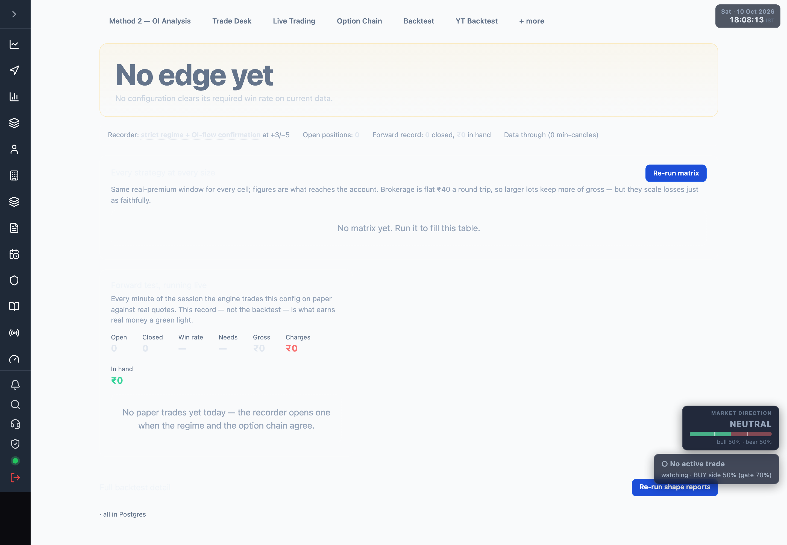

# 7.8 Scalp Desk {#scalp-desk}

The mean-reversion scalp engine: it tests every strategy at every size, forward-tests the
chosen config live on paper, and reports what reaches the account after charges.

Open at <a href="/admin/scalp" target="_blank" rel="noopener noreferrer">Scalp Desk</a>.
Everything refreshes every ~30s.

## Verdict band {#verdict}

The one answer the page exists to give: the best configuration found across all tested cells —
strategy, lot size, window, and in-hand net after every charge, with its achieved vs required
win rate. Lot chips show the same strategy at each size. When nothing clears its required win
rate it reads **No edge yet**. A daily P&L bar chart sits alongside — one bar per session, hover
for the day.

## Status strip {#status}

One line of live state: the recorder's config and its target/stop points, open positions, the
forward record (closed count and in-hand), and how far the candle data runs.

## Every strategy at every size {#matrix}

A strategy × lots table. Same real-premium window for every cell; figures are what reaches the
account (brokerage is flat ₹40 a round trip). Columns: strategy, trades, win rate, needed win
rate, then in-hand net for each lot size (✓ marks profitable). **Re-run matrix** rebuilds it;
empty until first run ("No matrix yet. Run it to fill this table.").

## Monthly projection {#projection}

If the month looks like the measured days: sessions measured, average per session, daily swing,
projected month, and the likely range.

## Forward test, running live {#paper}

Every minute of the session the engine paper-trades the chosen config against real quotes. This
record — not the backtest — is what earns real money a green light. Shows open, closed, win rate,
needed win rate, gross, charges, in hand, plus the open holding and recent closed trades. Empty
state: "No paper trades yet today — the recorder opens one when the regime and the option chain
agree."

## Full backtest detail {#detail}

Two collapsible tables, rebuilt with **Re-run shape reports**:

| Table | What it is |
| --- | --- |
| Real traded premiums | Shape by shape, on real option candles. Trust these for levels. |
| Modelled premiums | A longer, coarser 30-day comparison. Use for direction of change only. |

Each row lists trades, win rate, needed, gross, charges, slippage, and in-hand net.

:::note
Outside market hours or without a valid [Zerodha token](./02-connect-zerodha.md) the live
forward record stays empty and the candle archive stops advancing. Backtest tables still show
the last stored run.
:::
