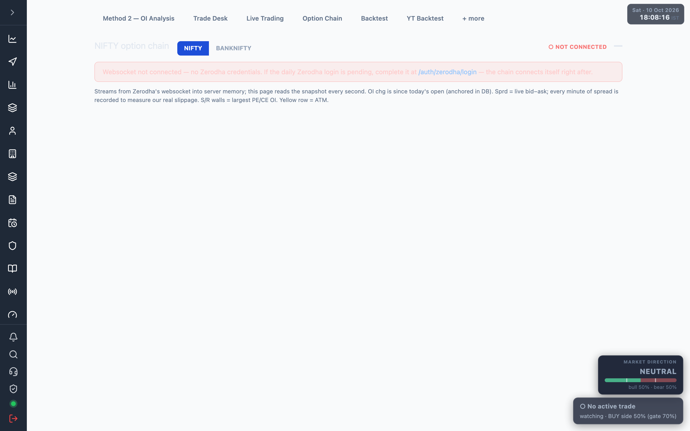

# 7.9 Option Chain {#option-chain}

The live option chain: calls and puts side by side around spot, with OI, spreads and the
support/resistance walls the engine reads.

Open at <a href="/admin/option-chain" target="_blank" rel="noopener noreferrer">Option Chain</a>.
The page reads a fresh server snapshot every second.

## Index selector {#selector}

Toggle between **NIFTY** and **BANKNIFTY**. The heading shows the symbol and current expiry;
spot price sits top-right with a connection badge.

| Badge | Meaning |
| --- | --- |
| ● LIVE — streaming | Ticks arriving (spot fresher than 15s). |
| ● connected, waiting for ticks | Websocket up, no fresh tick yet. |
| ○ NOT CONNECTED | No stream. |

## Empty / not-connected state {#empty}

Without Zerodha credentials or a pending daily login the table is empty and a banner reads
"Websocket not connected — no Zerodha credentials." with a link to the Zerodha login — the chain
connects itself right after. See [Connect Zerodha](./02-connect-zerodha.md).

## Reading the table {#table}

Each row is one strike, calls (CE) on the left, puts (PE) mirrored on the right. Columns each side:

| Column | Meaning |
| --- | --- |
| OI | Open interest (shown in lakhs, e.g. 12.3L). |
| OI chg | Change in OI since today's open, +/− (anchored in the database). |
| Vol | Volume traded. |
| Sprd | Live bid−ask spread; hover for bid/ask. Recorded each minute to measure real slippage. |
| LTP | Last traded price, green/red by day change. |

## Walls, ATM and bookmarks {#walls}

- **S wall / R wall** tags mark the strikes with the largest PE / CE open interest — the support
  and resistance walls. Their OI cells are highlighted.
- The **ATM** row (listed strike nearest spot) is shaded yellow.
- Click the ☆ star on any strike to bookmark it; bookmarked strikes pin to a chip strip above the
  table showing CE/PE LTP and OI change, and persist across sessions.

:::note
OI change is measured from today's open, so it reads near zero at the start of the session and
builds through the day. Outside market hours the snapshot holds the last known values.
:::
