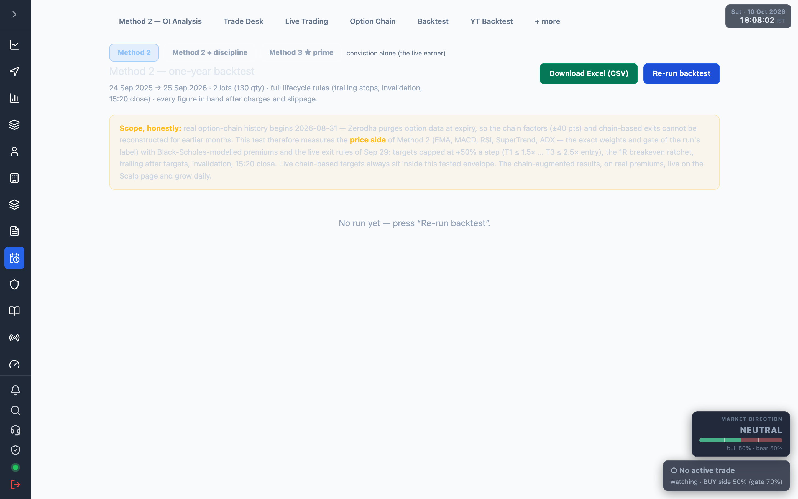
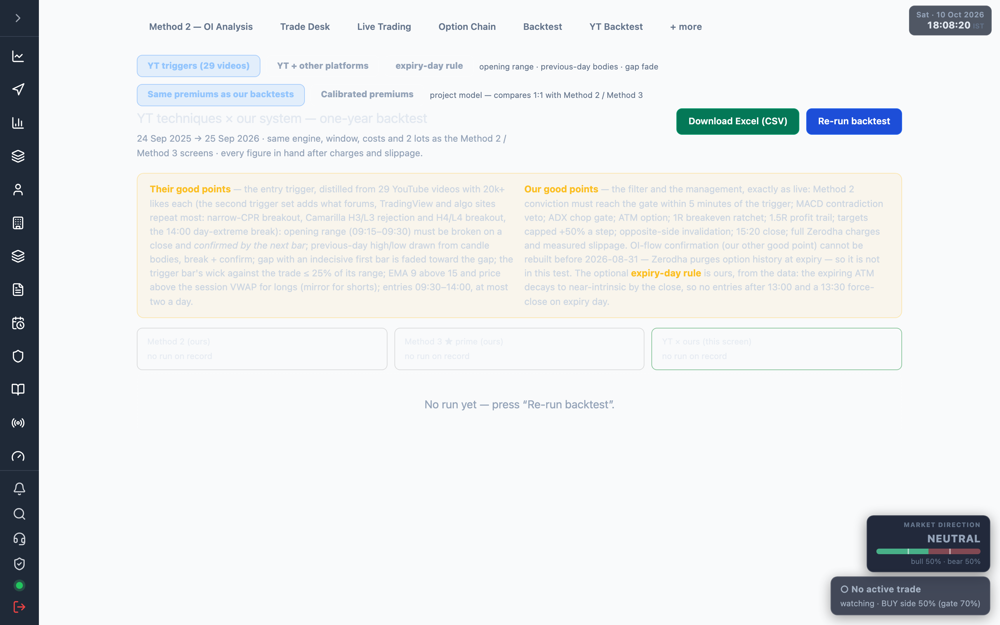

# 7.10 Backtests {#backtests}

One-year strategy backtests over 24 Sep 2025 → 25 Sep 2026, 2 lots (130 qty), with full
lifecycle rules (trailing stops, invalidation, 15:20 close). Every figure is quoted **in hand** —
after Zerodha charges and slippage.

## Year Backtest {#year-backtest}

<a href="/admin/backtest" target="_blank" rel="noopener noreferrer">Open Year Backtest</a>.
Pick the engine with the three buttons at the top — the choice also follows a `?m=` URL
param (`m2p` / `m3`).

| Button | Engine |
| --- | --- |
| Method 2 | Conviction alone — the live earner. |
| Method 2 + discipline | Live Method 2 plus the rules that held up across prior years. |
| Method 3 ★ prime | Breakout × conviction — fewer, higher-grade trades. |

### Controls {#year-controls}

| Control | What it does |
| --- | --- |
| Download Excel (CSV) | Exports the full trade log for the selected engine. |
| Re-run backtest | Re-runs the one-year window; takes about a minute. |

### What the report shows {#year-report}

- **Headline cards** — Trades, Win rate (with the win rate it *needs*), Gross, Charges,
  Slippage, and the **In hand** hero card (net, profit factor, max drawdown).
- **Month by month** — trades, wins and in-hand net per month.
- **How trades ended** — count and share per resolution (T3 target, trailing stop, stop
  loss, thesis reversed, day close 15:20), with an average-win vs average-loss note.
- **Trade log** — latest 100 trades (date, time, call, contract, confidence, entry, exit,
  resolution, hold, in hand). The full log is in the CSV.
- A **scope note** states the test measures the price side of the engine with modelled
  premiums; real option-chain history only begins 2026-08-31.

:::note Empty state
If no run is on record, the report shows **"No run yet — press 'Re-run backtest'."** Connect
Zerodha and re-run to populate it. See [Connect your Zerodha account](./02-connect-zerodha.md).
:::

## YT Backtest {#yt-backtest}

<a href="/admin/yt-backtest" target="_blank" rel="noopener noreferrer">Open YT Backtest</a>.
Tests popular YouTube / forum **entry triggers** filtered and managed by the live Method 2
engine, over the same window and costs.

### Controls {#yt-controls}

| Control | Values | What it does |
| --- | --- | --- |
| Trigger set | YT triggers (29 videos) / YT + other platforms | Opening-range, previous-day bodies and gap-fade; the second set adds narrow-CPR, Camarilla and 14:00 day-extreme triggers. |
| Expiry-day rule | off / on | Ours, from the data: on expiry day no entries after 13:00 and a 13:30 force-close. |
| Premiums | Same premiums as our backtests / Calibrated | Project model compares 1:1 with Method 2 / 3; calibrated uses IV measured on the real chain. |
| Download Excel (CSV) | — | Exports the full trade log for the current selection. |
| Re-run backtest | — | Re-runs the window for the current selection. |

### What it adds {#yt-report}

- A **like-for-like strip** compares this run against the Method 2 and Method 3 year
  backtests (net, trades, win %, profit factor, drawdown). A peer with no run shows **"no
  run on record"**.
- A **"Which of their triggers paid"** panel — trades, win rate and in-hand net per trigger.
- The same headline cards, month-by-month, outcome breakdown and 100-trade log as the Year
  Backtest, plus a **Trigger** column in the log.

The entry trigger comes from the YouTube/forum techniques; the conviction gate, MACD veto,
ADX gate, breakeven ratchet, profit trail, capped targets, invalidation and 15:20 close are
the live Method 2 rules. See [Method 2](./05-method-2.md) and
[Trading configuration](./03-trading-configuration.md).
