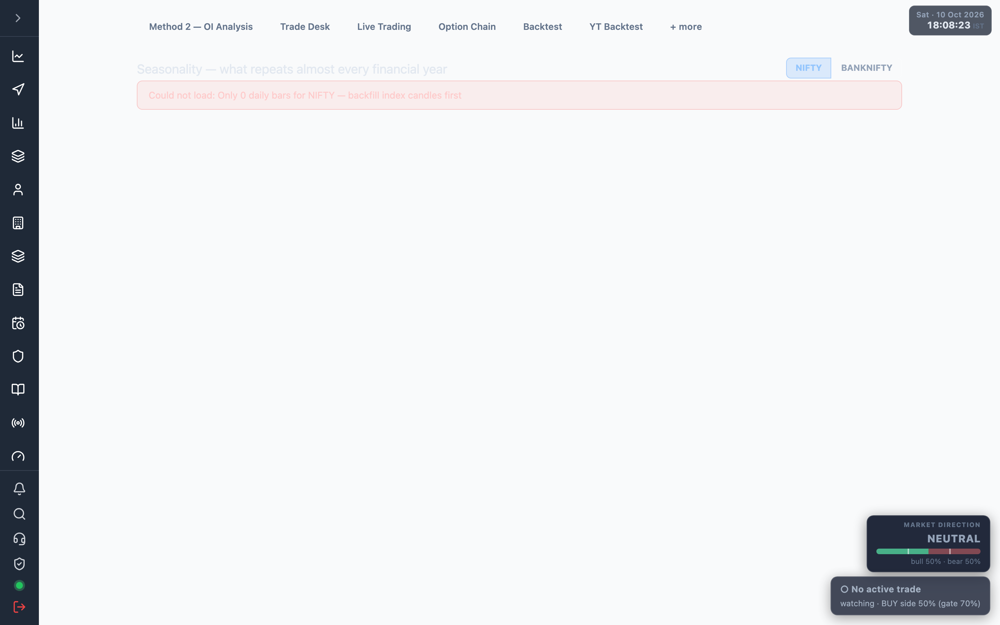

# 7.11 Seasonality {#seasonality}

Repeating calendar patterns across financial years (Apr 1 → Mar 31), plus a switch that leans
the live Method 2 score toward the month's seasonal bias.

<a href="/admin/seasonality" target="_blank" rel="noopener noreferrer">Open Seasonality</a>.
Switch the symbol with the **NIFTY / BANKNIFTY** toggle; the whole screen recomputes from
that symbol's daily history.

## Findings and heatmap {#heatmap}

- **Findings cards** — each names a repeating pattern, shows in how many years it held, and
  (where known) the flow/behaviour theory behind it.
- **FY × month heatmap** — month-end-to-month-end % change per financial year, green for up
  and red for down, shaded by size. A `*` marks a partial year; a `·` marks a missing month.
- **Month-by-month consistency** — years up, hit rate bar, average, median, worst and best
  per month. Qualifying months are highlighted.
- **Day of week** and **Time of day** tables — average move and up-rate per weekday and per
  half-hour window.
- **Turn of month** — average move on the last 2 + first 3 trading days vs all other days.

A pattern counts only if the month closed the same colour in at least 7 of 10 analysed years
(≥70%, minimum 6 years). Everything below that is treated as noise.

## Seasonal tilt on live Method 2 {#tilt}

The **TILT ON / TILT OFF** switch leans the live score when a month qualifies.

| Behaviour | Detail |
| --- | --- |
| Effect size | ±2 points (~1% of conviction) toward calls or puts for a qualifying month. |
| Current month | The switch text states whether this month qualifies and which way it leans. |
| Beneficial months | Listed below the switch — up-side months favour calls, down-side months favour puts. |
| Measured effect | +7.8% net on the last year's backtest, −0.9% across 4 years — helps ranging years, costs a little in strong trends. |

:::note
A tilt is a nudge, not a signal — it never places or blocks a trade on its own. A change to
the switch reaches the live score from the next server reload (evenings).
:::

:::warning
Without Zerodha data the daily history cannot be built — the screen shows **"Could not
load…"** or stays on **"Crunching … daily history…"**. See
[Connect your Zerodha account](./02-connect-zerodha.md).
:::

See [Method 2](./05-method-2.md) for the engine the tilt feeds, and
[How it works](./12-how-it-works.md) for how the score is built.
