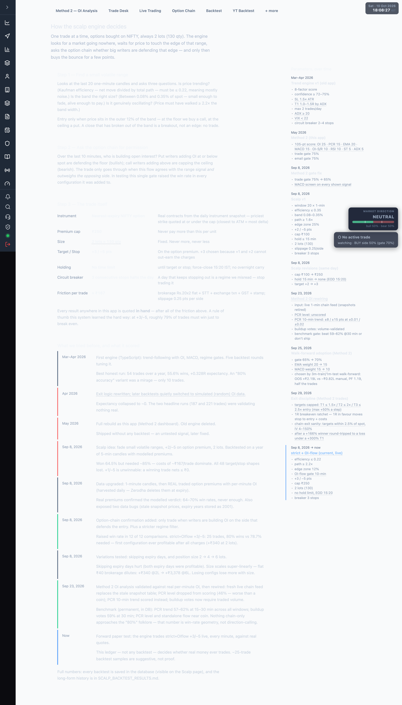

# 7.12 How it works {#how-it-works}

A plain-language explainer of how the scalp engine decides, the full experiment record, and
the parameter sets in force over time.

<a href="/admin/system-logic" target="_blank" rel="noopener noreferrer">Open How it works</a>.
The engine trades one position at a time, options bought on NIFTY, always 2 lots (130 qty).

## How the scalp engine decides {#decision}

| Step | What it checks |
| --- | --- |
| 1 — Find a small volatile range | Last ~20 one-minute candles: price barely trending (low Kaufman efficiency), band the right size (% of spot), genuinely oscillating (path ≥ band width × multiple). Entry only in the outer edge zone — floor buys a call, ceiling a put; a break *out* of the band is no trade. |
| 2 — Ask the option chain for permission | Over the last ~10 minutes, whether writers are defending the edge (put writers below spot = bullish, call writers above = bearish). The trade goes through only when this flow agrees with the range signal and outweighs the opposing side. |
| 3 — The trade itself | Nearest-expiry NIFTY option under the premium cap, fixed size, fixed target/stop on the premium, no time limit but a 15:20 force-close, and a circuit breaker after consecutive stops. |

The Step 3 table reads the **live parameter values** from the engine config. If the config
cannot load, a banner warns the shown values may be stale.

:::note
Every result in the app is quoted **in hand** — after brokerage, taxes and slippage. At the
current +3/−5 target/stop, roughly 79% of trades must win just to break even.
:::

## What we tried before {#history}

A dated timeline of each experiment — what was changed, what it scored, and whether it was a
step forward, a dead end, or the current live configuration. It records honest failures
(simulated-data runs, shapes that lost to costs) alongside the first profitable configuration
and the current live forward paper test.

## Parameters, over time {#parameters}

The right rail lists each parameter set and when it was in force — from the first trend
engine, through the Method 2 score and gate changes, the scalp revisions, the OI rewiring and
walk-forward adoption, to the current live **strict + OI-flow** set (marked as current).

To change the values that drive the live engines today, see
[Trading configuration](./03-trading-configuration.md).

:::warning
Live quotes and the per-minute OI the engine needs come from Zerodha — without a connected
token the decision steps hold and the parameter table may fall back to defaults. See
[Connect your Zerodha account](./02-connect-zerodha.md).
:::
